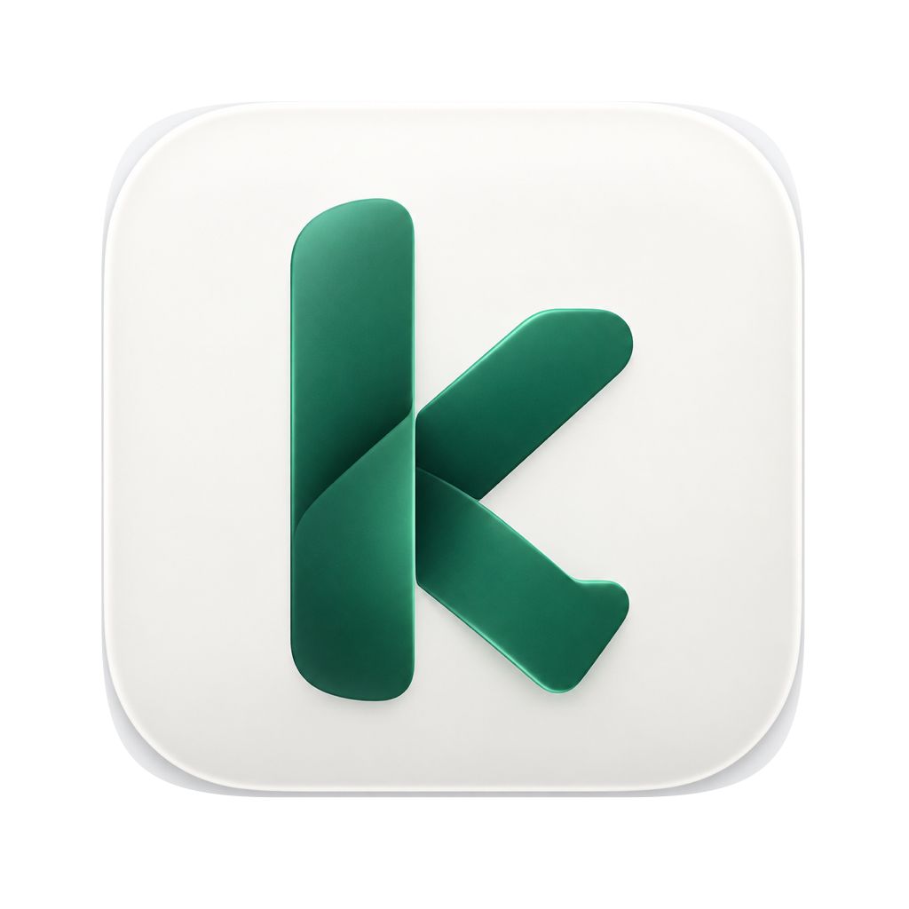
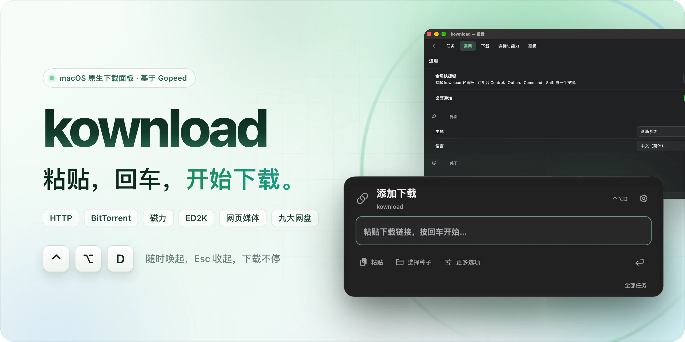
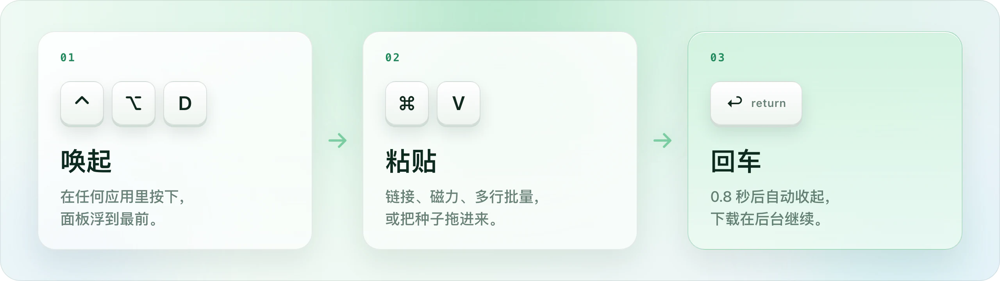
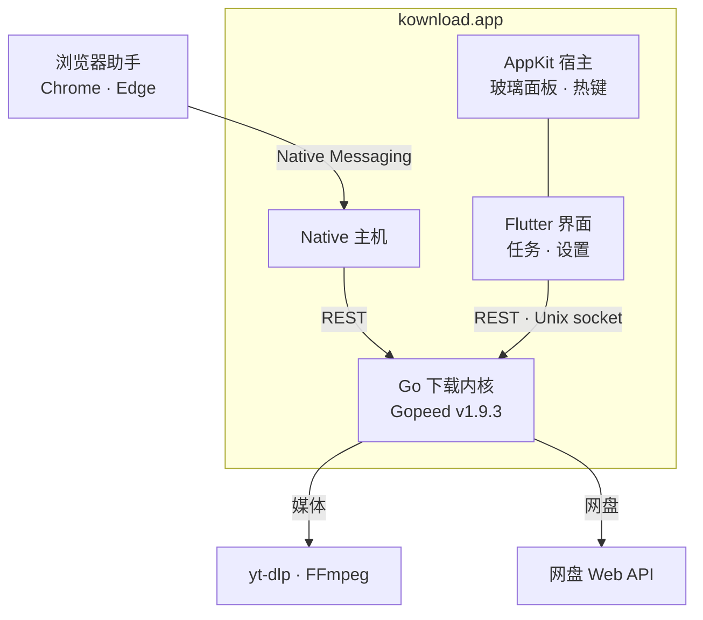

<a id="readme-top"></a>

<div align="center">

<p>
  <a href="docs/BRAND.md"></a>
</p>

<picture>
  <source media="(prefers-color-scheme: dark)" srcset="docs/images/readme/hero-dark.webp">
  <source media="(prefers-color-scheme: light)" srcset="docs/images/readme/hero-light.webp">
  
</picture>

<h3>下载器，不必是一个要专门切过去的窗口。</h3>

kownload 常驻菜单栏。在任何应用里按下 <kbd>⌃</kbd> <kbd>⌥</kbd> <kbd>D</kbd>，一块原生玻璃面板浮到最前；<br>
粘贴链接，按下回车，它自己收起，文件在后台下完。

<sub>A keyboard-first, native-glass download panel for macOS, powered by the Gopeed engine.</sub>

<p>
  
  
  
  <br>
  
  
  
  <a href="LICENSE"></a>
</p>

<p>
  <a href="#-三步开始下载"><b>三步上手</b></a> &nbsp;·&nbsp;
  <a href="#-亮点"><b>亮点</b></a> &nbsp;·&nbsp;
  <a href="#netdisk"><b>九大网盘</b></a> &nbsp;·&nbsp;
  <a href="#-安装"><b>安装</b></a> &nbsp;·&nbsp;
  <a href="#-快捷键"><b>快捷键</b></a> &nbsp;·&nbsp;
  <a href="#-架构"><b>架构</b></a> &nbsp;·&nbsp;
  <a href="#-文档"><b>文档</b></a>
</p>

</div>

## ⚡ 三步开始下载

<picture>
  <source media="(prefers-color-scheme: dark)" srcset="docs/images/readme/steps-dark.webp">
  <source media="(prefers-color-scheme: light)" srcset="docs/images/readme/steps-light.webp">
  
</picture>

面板上最多列出 3 条未完成的任务，可以就地暂停、继续。完整任务列表、全部下载参数和扩展维护收在设置里，用到时再展开。

<details>
<summary><b>📸 查看实机截图</b></summary>
<br>
<p align="center"></p>
<p align="center"></p>
</details>

## ✨ 亮点

<table>
<tr>
<td width="33%" valign="top">

### 🪟 原生玻璃

AppKit `NSGlassEffectView` 直接承载界面，跟随系统明暗、“减少透明度”和“减少动态效果”；早于 macOS 26 的系统自动换用 `NSVisualEffectView`。

</td>
<td width="33%" valign="top">

### 🎹 键盘优先

全局快捷键可以重新录制，<kbd>Esc</kbd> 或点一下别处就收起。没写完的链接、等待中的网盘登录，隐藏再回来都还在。

</td>
<td width="33%" valign="top">

### 🔗 一个入口

普通链接、多行批量、磁力链接、`.torrent` 拖放和 ED2K 共用同一个输入框；文件选择、保存位置等参数按需展开。

</td>
</tr>
<tr>
<td width="33%" valign="top">

### 🎬 网页媒体

浏览器助手给每个播放器单独放一个下载按钮，可选清晰度、音轨和字幕；支持 HLS（含 AES-128）、DASH，音视频自动合并。

</td>
<td width="33%" valign="top">

### ☁️ 网盘直下

在百度、阿里、夸克等九类网盘的网页里勾选文件，一键交给 kownload；分享链接也能直接粘贴进面板。

</td>
<td width="33%" valign="top">

### 🚀 Gopeed 内核

多连接分片、断点续传、BT 做种、自动解压、扩展商店与 REST API 全部保留；原有的任务、配置和扩展直接沿用。

</td>
</tr>
</table>

## 🧭 能下载什么

| 类型 | 支持内容 |
| :-- | :-- |
| 🌐 **HTTP / HTTPS** | 多连接分片、断点续传、自定义 UA、分类保存目录 |
| 🧲 **BT / 磁力** | 拖入 `.torrent`、挑选文件、Tracker 订阅、做种策略 |
| 🔗 **ED2K** | 内置 ed2k 协议，可配置服务器与节点 |
| 🎬 **网页媒体** | 视频、音频、图片；HLS（含 AES-128）与 DASH；音视频自动合并 |
| ☁️ **网盘** | 九类网盘的个人文件与分享链接，需要时临时转存，下载完成后清理副本 |
| 🧩 **扩展** | Gopeed 扩展商店，按需安装与升级 |

直播与 DRM 保护的内容不在支持范围内。网页媒体依赖 yt-dlp 与 FFmpeg，安装方法见[媒体下载依赖](#媒体下载依赖)。

## <a id="netdisk"></a>☁️ 九大网盘

在网盘网页里勾选文件，点页面右下角的 **kownload 下载**，浏览器助手会把选中的文件和当前登录状态交给应用；也可以直接把分享链接粘贴进面板。

| 网盘 | 个人文件 | 分享链接 | 转存 | 实测 |
| :-- | :-: | :-: | :-: | :-: |
| 夸克网盘 | ✅ | ✅ | ✅ | ✅ |
| 百度网盘 | ✅ | ✅ | ✅ | 🧪 |
| 阿里云盘 | ✅ | ✅ | ✅ | 🧪 |
| 天翼云盘 | ✅ | ✅ | ✅ | 🧪 |
| 迅雷云盘 | ✅ | ✅ | ✅ | 🧪 |
| UC 网盘 | ✅ | ✅ | ✅ | 🧪 |
| 光鸭云盘 | ✅ | ✅ | ✅ | 🧪 |
| 中国移动云盘 | ✅ | ✅ | 直链 | 🧪 |
| 123 云盘 | ✅ | ✅ | 直链 | 🧪 |

<sub>✅ 已实现　🧪 已实现，通过模拟接口测试，等待真实账号验收　直链：分享文件直接取得下载地址，无需转存</sub>

夸克已用真实账号跑通分享文件下载、暂停重启后的断点续传和个人空间列举。

登录凭据只保存在内存里，任务只记录文件身份。暂停或重启后，重新打开对应的网盘页面同步登录状态，即可从断点继续。实现与验证细节见 [NETDISK_PROVIDERS.md](NETDISK_PROVIDERS.md)。

## 📦 安装

目前通过源码构建安装，环境就绪后三条命令完成。

**环境**：macOS 12 或更新版本 · Apple Silicon · 完整 Xcode 与 CocoaPods · Flutter 3.41.2 · Go 1.24

```sh
git clone https://github.com/kbwumin13-sudo/kownload.git && cd kownload
scripts/macos-frontend-build.sh
ditto ui/flutter/build/macos/Build/Products/Release/Gopeed.app /Applications/kownload.app
```

构建脚本依次编译 Go 内核与 Native 主机、构建 Flutter 前端并完成签名，中间文件写入仓库上一级的 `artifacts/build/`。也可以用 `FLUTTER_BIN`、`GO_BIN` 指定工具链。产物目录沿用上游名称 `Gopeed.app`，复制时改名为 `kownload.app` 即可。

> [!TIP]
> 已经在用 Gopeed？kownload 读写同一个数据目录（`com.gopeed.gopeed`），任务、配置和扩展会直接接上。先退出 Gopeed 再打开 kownload，避免两个下载引擎同时使用同一个数据库。

### 浏览器助手

1. 打开 `chrome://extensions` 或 `edge://extensions`，开启「开发者模式」。
2. 点「加载已解压的扩展程序」，选择仓库里的 [`browser-media-extension/`](browser-media-extension/)。
3. 启动一次 kownload，应用会为 Chrome 和 Edge 注册 Native Messaging 主机。

### 媒体下载依赖

```sh
brew install ffmpeg node pipx
pipx install yt-dlp    # 安装到 ~/.local/bin/yt-dlp
```

kownload 默认使用 `~/.local/bin/yt-dlp`、`/opt/homebrew/bin/ffmpeg` 和 `/opt/homebrew/bin/node`。装在别处时，到「设置 › 下载 › 媒体下载」里改成实际路径。

## 🎹 快捷键

| 快捷键 | 作用 |
| :-- | :-- |
| <kbd>⌃</kbd> <kbd>⌥</kbd> <kbd>D</kbd> | 唤起 / 收起轻面板，可在「设置 › 通用」重新录制 |
| <kbd>↩</kbd> | 开始下载 |
| <kbd>Esc</kbd> | 收起面板；输入法候选、菜单和弹窗会先关闭 |
| <kbd>⌘</kbd> <kbd>N</kbd> | 新建下载 |
| <kbd>⌘</kbd> <kbd>F</kbd> | 搜索完整任务列表 |
| <kbd>⌘</kbd> <kbd>,</kbd> | 打开设置 |
| <kbd>⌥</kbd> <kbd>⌘</kbd> <kbd>I</kbd> | 任务详情 |
| <kbd>⌘</kbd> <kbd>A</kbd> | 全选任务（任务列表聚焦时） |
| <kbd>⌘</kbd> <kbd>W</kbd> | 隐藏窗口 |

## 🧩 架构



| 层 | 技术 | 职责 |
| :-- | :-- | :-- |
| **原生宿主** | Swift · AppKit · Carbon | 玻璃材质、全局快捷键、菜单栏常驻 |
| **界面** | Flutter 3.41 · GetX | 创建流程、任务列表、五类设置、网盘确认 |
| **下载内核** | Go 1.24 · Gopeed v1.9.3 | HTTP / BT / ED2K、媒体与网盘协议、REST API |
| **浏览器助手** | Chrome / Edge MV3 | 播放器级媒体嗅探、网盘文件与登录状态同步 |
| **媒体工具** | yt-dlp · FFmpeg · Node | 解析清单、选择格式、合并音视频 |

## 🧪 质量与验证

2026-10-14 在 macOS 27 · Apple Silicon 上完成：

| 范围 | 结果 |
| :-- | :-- |
| Flutter 全量回归 | ✅ 90 项通过 |
| 浏览器助手回归 | ✅ 187 项通过 |
| 原生宿主与输入路由 | ✅ AppKit、鼠标与拖放回归通过 |
| HTTP 下载 | ✅ 64 MiB 文件，SHA-256 一致 |
| 网盘下载 | ✅ 夸克分享文件 439 MB，ZIP 78 项 CRC 全部通过 |
| 从 Gopeed 升级 | ✅ 既有任务、扩展与完整配置保持一致 |
| 待实机验收 | 真实输入法候选会话、多屏与全屏空间；夸克以外八类网盘的真实账号 |

完整记录见[原生面板验收](docs/NATIVE_PANEL_VALIDATION.md)。

## 🔧 开发

```sh
# Flutter 界面
cd ui/flutter && flutter pub get && flutter analyze && flutter test

# 原生宿主回归（需要先构建插件模块）与鼠标、拖放路由
python3 ui/flutter/macos/tests/run_panel_host_tests.py
bash scripts/test-macos-pointer-routing.sh

# 浏览器助手
cd browser-media-extension && node --test
```

调试时可以用隔离数据启动，不碰正式任务和配置：

```sh
GOPEED_PREVIEW_STORAGE=/tmp/kownload-preview \
  ui/flutter/build/macos/Build/Products/Release/Gopeed.app/Contents/MacOS/Gopeed
```

预览模式使用独立数据库和通信地址，并跳过浏览器注册、开机启动和更新检查。

## 📚 文档

| 文档 | 内容 |
| :-- | :-- |
| [MACOS_FRONTEND.md](MACOS_FRONTEND.md) | 构建、窗口与视觉、隔离实测、安装与回退 |
| [DESIGN.md](DESIGN.md) | 产品与视觉设计约定 |
| [docs/BRAND.md](docs/BRAND.md) | 应用图标与菜单栏模板图标 |
| [MEDIA_SNIFFER.md](MEDIA_SNIFFER.md) | 媒体引擎、浏览器助手与接口 |
| [NETDISK.md](NETDISK.md) | 网盘 REST 接口与任务流程 |
| [NETDISK_PROVIDERS.md](NETDISK_PROVIDERS.md) | 九类网盘的实现范围与验证 |
| [docs/NATIVE_PANEL_VALIDATION.md](docs/NATIVE_PANEL_VALIDATION.md) | 原生面板验收记录 |
| [docs/GOPEED_UPSTREAM.md](docs/GOPEED_UPSTREAM.md) | 上游 Gopeed 的原始介绍 |

<details>
<summary><b>🌏 English</b></summary>

<br>

**kownload** is a keyboard-first download manager for macOS. Press <kbd>⌃</kbd> <kbd>⌥</kbd> <kbd>D</kbd> anywhere to summon a native glass panel, paste a link and hit <kbd>Return</kbd>: the panel tucks itself away while the download keeps running in the background.

- **One input for everything**: HTTP(S), BitTorrent, magnet links, `.torrent` drops, ED2K and multi-line batches.
- **Web media**: the browser assistant adds a download button to each video player, with quality, audio-track and subtitle choices; HLS (including AES-128) and DASH streams are merged with FFmpeg.
- **Nine Chinese cloud drives**: Baidu, Aliyun, China Mobile, Tianyi, Xunlei, Quark, UC, 123 and Guangya. Select files on the drive's web page and send them to kownload.
- **Gopeed engine**: multi-connection downloads, resume, seeding, auto-extract, the extension store and the REST API. Existing Gopeed tasks, settings and extensions carry over.

Build it with `scripts/macos-frontend-build.sh` on macOS 12+ with Apple Silicon, Xcode, CocoaPods, Flutter 3.41.2 and Go 1.24. kownload is GPL-3.0 software based on [Gopeed](https://github.com/GopeedLab/gopeed).

</details>

## 🙏 致谢与许可

kownload 基于 [GopeedLab/gopeed](https://github.com/GopeedLab/gopeed) v1.9.3，在它的下载内核之上重做了 macOS 交互。为了让既有任务、配置和浏览器助手无缝延续，保留了 `com.gopeed.gopeed` 数据标识、`gopeed:` URL scheme 与 Native Messaging 标识；内部 Go module 和 Flutter package 名沿用上游，产品显示名称为 kownload。

| 项目 | 用途 | 许可 |
| :-- | :-- | :-- |
| [Gopeed](https://github.com/GopeedLab/gopeed) | 下载内核与 Flutter 前端基础 | GPL-3.0 |
| [LinkSwift](https://github.com/hmjz100/LinkSwift) | 网盘网页的文件选择逻辑参考 | AGPL-3.0 |
| [OpenList](https://github.com/OpenListTeam/OpenList) | 网盘驱动接口参考 | AGPL-3.0 |
| [yt-dlp](https://github.com/yt-dlp/yt-dlp) · [FFmpeg](https://ffmpeg.org) | 媒体解析与合并，运行时调用 | 各自许可 |

本项目以 [GPL-3.0](LICENSE) 发布；LinkSwift、OpenList 的许可证与归属说明保存在 [`third_party/`](third_party/)。

<div align="center">

<br>

<sub>如果 kownload 帮你少切了几次窗口，欢迎点一颗 ⭐</sub>

<sub><a href="#readme-top">回到顶部 ↑</a></sub>

</div>
