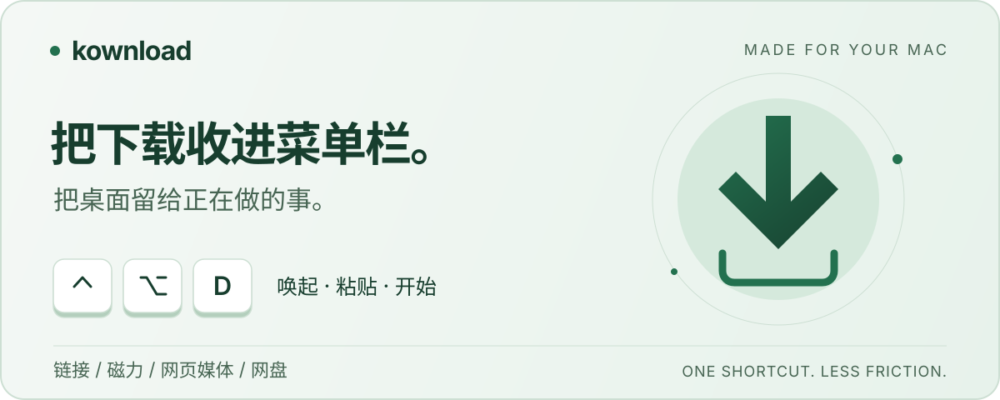

<a id="readme-top"></a>

<picture>
  <source media="(prefers-color-scheme: dark)" srcset="docs/images/kownload-hero-dark.svg">
  <source media="(prefers-color-scheme: light)" srcset="docs/images/kownload-hero-light.svg">
  
</picture>

<div align="center">

# kownload

**把下载收进菜单栏，把桌面留给正在做的事。**

按下 **⌃⌥D**，粘贴，回车。普通文件、磁力链接、网页媒体和网盘，都有一个顺手的入口。

A keyboard-first download manager for macOS. Paste a link. Get back to what matters.

[**下载 macOS 版 ↗**](https://github.com/kbwumin13-sudo/kownload/releases/latest) · [三步开始](#安装) · [浏览器助手](#浏览器助手) · [反馈与建议](https://github.com/kbwumin13-sudo/kownload/issues)


<a href="LICENSE"></a>

</div>

## 小面板，接住各种下载

| 拿到一个链接 | 看到一段好内容 | 收到一个网盘分享 |
| :-- | :-- | :-- |
| 唤起面板，粘贴后回车。多条链接也可以一起交给它。 | 用浏览器助手从播放器选择视频、音轨或字幕，交给应用下载。 | 粘贴分享链接，或在网页勾选文件后交给应用；文件和目录都能接。 |
| **HTTP / HTTPS · BT / 磁力 · ED2K** | **HLS · DASH · FFmpeg 合并** | **九个网盘适配 · 验证范围见下方** |

<p align="center">
  
  <br>
  <sub>轻面板实际截图 · build 19；当前发行版的细节以 Release 为准。</sub>
</p>

### 随手唤起，安心放到后台

- **不挤占桌面。** 默认只在菜单栏，不占程序坞和 ⌘Tab。喜欢常规应用的切换方式，也能在设置中打开程序坞图标。
- **下载有来有回。** 支持暂停和断点恢复；HTTP 下载先验证服务器的 Range 能力，再启用多连接分段。
- **收起，再接着来。** 面板隐藏后保留输入与等待中的登录流程；系统字体、紧凑控件和明暗外观融入 macOS。
- **常用操作靠键盘。** 开始、搜索、新建、查看详情都有快捷键，完整列表见下方。

<details>
<summary><strong>看看设置界面</strong></summary>

<p align="center">
  
</p>

第一次使用会引导你选择下载目录、连接浏览器助手；之后可在「设置 → 通用 → 使用引导」重新打开。

</details>

<a id="安装"></a>

## 安装

**macOS 12+ · Apple Silicon（M 系列芯片）**。当前独立发行版面向这一平台，其他平台源码尚未作为独立版本发行。

1. **下载。** 前往 [最新 Release](https://github.com/kbwumin13-sudo/kownload/releases/latest)，下载 `.dmg` 安装包。
2. **装好。** 打开 DMG，将 **kownload.app** 拖入 **Applications**；升级前先退出正在运行的应用。
3. **开始。** 打开应用，按引导设置保存位置。按 **⌃⌥D** 唤起面板，粘贴链接，按 **↩** 开始下载。

本版使用本机 ad-hoc 签名，**未做 Apple 公证**。首次打开如被系统拦截，在「系统设置 → 隐私与安全性」中选择「仍要打开」。系统询问「下载」文件夹的访问权限时，请选择允许。

<details>
<summary><strong>从 build 25 或更早版本升级</strong></summary>

从 build 25 及更早版本升级时，首次打开会把旧数据目录 `~/Library/Application Support/com.gopeed.gopeed` 只读导入到 `~/Library/Application Support/io.github.kbwumin13-sudo.kownload`，任务、设置和扩展继续沿用，旧目录保持不变；导入前请先退出旧版。导入后到「设置 → 通用 → 浏览器助手」点「连接…」，再按下文重新加载浏览器助手。回退步骤见对应 Release 说明。

</details>

<a id="浏览器助手"></a>

### 浏览器助手

让网页上的下载入口直接连接 kownload，适用于 **Chrome / Edge**。

1. 在应用首次引导中打开助手目录；也可从 [Release 下载助手 ZIP](https://github.com/kbwumin13-sudo/kownload/releases/latest) 并解压。
2. 打开 `chrome://extensions` 或 `edge://extensions`，开启「开发者模式」，选择「加载已解压的扩展程序」，加载助手目录。
3. 到应用「设置 → 通用 → 浏览器助手」点「连接…」，完成浏览器连接。助手更新后，在扩展页点「重新加载」。

当前 build 30 配套文件为 `kownload-browser-helper-0.4.2-1.9.3-kownload.18.zip`。[助手源码与说明 →](browser-media-extension/)

### 下载网页媒体

媒体功能需要另外安装以下工具；普通文件下载不需要这一步。

```sh
brew install ffmpeg node pipx
pipx install yt-dlp
```

默认路径为 `~/.local/bin/yt-dlp`、`/opt/homebrew/bin/ffmpeg` 和 `/opt/homebrew/bin/node`。安装在其他位置时，在下载设置中填写实际路径。**直播和 DRM 保护内容不在支持范围内。**

## 能下载什么

| 类型 | 已实现的能力 |
| :-- | :-- |
| HTTP / HTTPS | 多连接分段、连接复用、断点续传、自定义请求参数 |
| BT / 磁力 | 种子文件选择、Tracker、做种策略 |
| ED2K | ed2k 协议、服务器与节点设置 |
| 网页媒体 | 视频、音频、图片；HLS（含 AES-128）、DASH |
| 网盘 | 分享链接、网页选中文件、文件与目录任务；各平台能力有差异 |

### 九个网盘，明确标注验证进度

| 平台 | 验证状态 |
| :-- | :-- |
| **百度 · 夸克** | 文件与目录下载已有真实账号验收记录 |
| 阿里 · 天翼 · 迅雷 · UC · 光鸭 · 移动 · 123 | 已有适配实现与模拟接口测试覆盖，真实账号验收仍待补齐 |

网盘登录凭据保留在内存中，任务保存文件身份。暂停或重启后，按提示打开对应网页并同步登录状态，再继续下载。登录、分享、转存与恢复的具体边界见 [网盘能力矩阵](NETDISK_PROVIDERS.md)。

## 用键盘，更顺手

| 快捷键 | 作用 | 快捷键 | 作用 |
| :-- | :-- | :-- | :-- |
| **⌃⌥D** | 唤起 / 收起面板，可重新设置 | **⌘N** | 新建下载 |
| **↩** | 开始下载 | **⌘F** | 搜索任务 |
| **Esc** | 收起面板 | **⌘,** | 打开设置 |
| **⌥⌘I** | 查看任务详情 | | |

## 开放，也交代清楚

- **源码开放。** 以 [GPL-3.0](LICENSE) 发布，保留完整的 [第三方许可与版权声明](THIRD_PARTY_NOTICES.md)。
- **更新由你决定。** 应用只提示新版本并打开 Release 页面，手动下载和安装。
- **没有内置在线扩展市场或安装统计上报。** 已安装扩展、配置、更新与手动 Git URL 安装继续保留。

### 当前发行版 · build 30

`1.9.3-kownload.18` · 浏览器助手 `0.4.2`。本版加入程序坞显示开关，并改用应用自己的系统文件选择框。[查看完整发行说明 →](https://github.com/kbwumin13-sudo/kownload/releases/tag/v1.9.3-kownload.18)

<details>
<summary><strong>版本改动与验证记录</strong></summary>

内核与 Release 版本 `1.9.3-kownload.18`，浏览器助手 0.4.2。

- 默认只在菜单栏，不占程序坞和 ⌘Tab；在「设置 → 通用」打开「在程序坞中显示 kownload」后立即生效，菜单栏随之切换。
- 文件夹和文件选择框改为应用自己的系统选择框，在轻面板和设置窗口里都会弹到前台。

程序坞开关、菜单栏切换和选择框已在实机上验证；.torrent、扩展目录和浏览器资料三处选择框只有测试覆盖。

build 28 起的改动：

- 修复下载完整性：大小未知或不支持 Range 的单流在失败、重试后不再被判为完成；换链或源站内容变化后，续传前先核对资源身份，不再把新旧版本拼成一个文件。
- Mail.ru 临时链接过期后自动刷新并回到原任务。
- 浏览器提交带操作 ID：应答丢失后重试不重复建任务，HTTP 状态与业务错误如实返回。
- 独立应用身份：新的 Bundle ID 与数据目录，首次启动只读导入旧数据；Native Messaging 主机独立实现；浏览器连接改为在设置里显式切换。
- 更新改为只提示新版本并打开 Release 页面；构建只接受干净提交，随包附完整许可声明与对应源码包。

build 28 经过三轮独立审查。HTTP 与下载调度相关 Go race、Flutter 194 项、浏览器助手 262 项回归通过；正式数据副本上的迁移、回退与再次升级，以及真实浏览器经助手提交下载均已验证。Mail.ru 链接过期后的真实续传、夸克和百度以外网盘的实际下载仍未验证。

build 19 的验证记录见 [docs/BUILD19_VALIDATION.md](docs/BUILD19_VALIDATION.md)。

</details>

## 参与开发

遇到问题或有个好点子？[提交 Issue](https://github.com/kbwumin13-sudo/kownload/issues)，附上应用版本、复现步骤和脱敏后的错误信息。欢迎改进代码、文档与平台适配。

需要 Xcode、CocoaPods、Flutter 3.41.2 和 Go 1.24 或更新版本。

```sh
git clone https://github.com/kbwumin13-sudo/kownload.git
cd kownload
scripts/macos-frontend-build.sh
```

可通过 `FLUTTER_BIN`、`GO_BIN` 指定工具链。构建与安装见 [macOS 前端开发](MACOS_FRONTEND.md)，发行与候选隔离见 [发行指南](docs/RELEASING.md)。版本由 `config/release.json` 统一管理。

<details>
<summary><strong>运行回归检查</strong></summary>

```sh
# Flutter 回归
cd ui/flutter
flutter test

# 浏览器助手回归（在仓库根目录执行）
node --test browser-media-extension/tests/*.test.js
```

</details>

| 想了解什么 | 从这里开始 |
| :-- | :-- |
| 界面与品牌 | [设计约定](DESIGN.md) · [品牌资源](docs/BRAND.md) |
| 下载能力 | [媒体引擎](MEDIA_SNIFFER.md) · [网盘接口](NETDISK.md) · [网盘验证](NETDISK_PROVIDERS.md) |
| 构建与历史 | [发行指南](docs/RELEASING.md) · [来源记录](docs/GOPEED_UPSTREAM.md) |

<details>
<summary>兼容性说明</summary>

独立应用身份已随 build 28 发布。浏览器助手仍使用兼容的 Native Messaging 名称 `com.gopeed.gopeed`，应用另注册 `gopeed:` 过渡链接。浏览器连接由设置中的「连接…」操作显式建立，应用启动时不会改动浏览器目录。

</details>

<p align="center">
  <a href="docs/BRAND.md"></a>
  <br>
  <strong>粘贴，回车，开始下载。</strong>
  <br>
  <a href="#readme-top">回到顶部 ↑</a>
</p>
