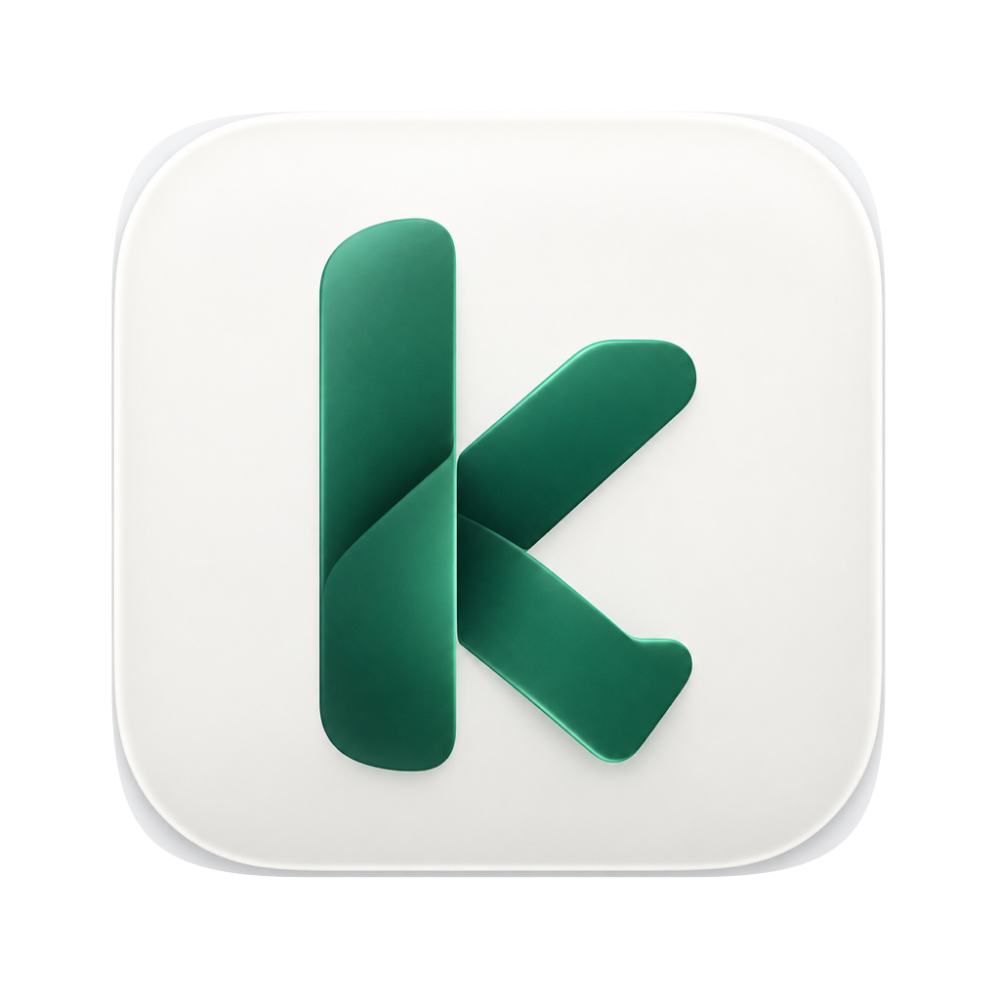
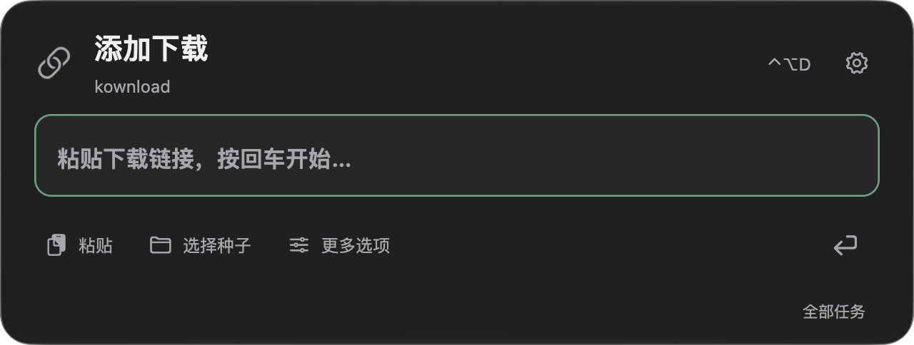
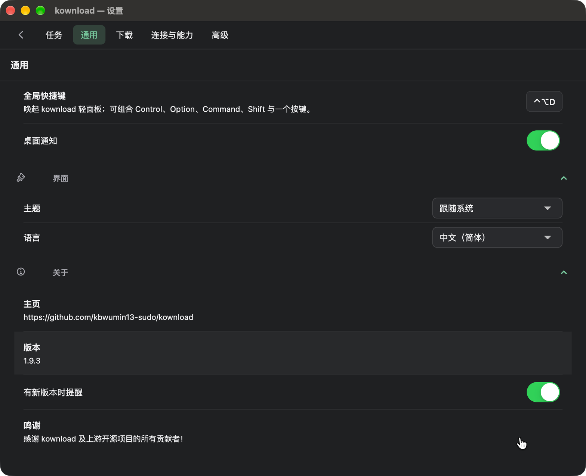

<a id="readme-top"></a>

<div align="center">

<a href="docs/BRAND.md"></a>

# kownload

### 粘贴，回车，开始下载。

常驻菜单栏的 macOS 下载面板。按下 **⌃⌥D**，粘贴链接，文件在后台下完。

A keyboard-first download manager for macOS.

[**下载 macOS · Apple Silicon**](https://github.com/kbwumin13-sudo/kownload/releases/latest) · [更新说明](https://github.com/kbwumin13-sudo/kownload/releases/latest) · [安装与使用](#安装)


<a href="LICENSE"></a>

<br><br>


</div>

## 随手开始，安静下载

- **轻面板**：系统字体、紧凑控件和分组设置，跟随系统明暗。隐藏后保留输入与等待中的登录流程。
- **只在菜单栏**：默认不占程序坞和 ⌘Tab；需要时在「设置 → 通用」打开「在程序坞中显示 kownload」。
- **一个输入框**：普通链接、多行批量、磁力、种子拖放、ED2K 和网盘分享链接。
- **自动分段**：验证服务器的 Range 能力后启用多连接，支持断点恢复和连接复用。
- **网页媒体**：浏览器助手按播放器提供下载入口，支持 HLS、DASH、音轨和字幕选择；音视频用 FFmpeg 合并。
- **网盘下载**：在网页勾选文件后交给应用，也可粘贴分享链接；支持文件与目录任务。
- **首次引导**：第一次使用时设置下载目录与浏览器助手；完成后不再自动显示，可在通用设置重新打开。

<details>
<summary>查看新设置界面</summary>



</details>

## 安装

**macOS 12 或更新版本，Apple Silicon（M 系列芯片）。**

1. [下载安装包](https://github.com/kbwumin13-sudo/kownload/releases/latest)。
2. 打开 DMG，将 **kownload.app** 拖入 **Applications**。
3. 打开应用，按引导完成设置。升级时先退出正在运行的应用，再替换。

本版使用本机 ad-hoc 签名，未做 Apple 公证。首次打开如被系统拦截，请在「系统设置 → 隐私与安全性」中选择「仍要打开」。新版本第一次读取「下载」文件夹时，系统会询问访问权限，请选择允许。

从 build 25 及更早版本升级时，首次打开会把旧数据目录 `~/Library/Application Support/com.gopeed.gopeed` 只读导入到 `~/Library/Application Support/io.github.kbwumin13-sudo.kownload`，任务、设置和扩展继续沿用，旧目录保持不变；导入前请先退出旧版。导入后到「设置 → 通用 → 浏览器助手」点「连接…」，再按下文重新加载浏览器助手。回退步骤见对应 Release 说明。

### 浏览器助手

应用的首次引导提供助手目录入口。在 `chrome://extensions` 或 `edge://extensions` 开启「开发者模式」，选择「加载已解压的扩展程序」，加载该目录。然后在「设置 → 通用 → 浏览器助手」点「连接…」，为 Chrome 和 Edge 写入 Native Messaging 清单；应用启动时不会改动浏览器目录。

也可以下载 Release 中的 **kownload-browser-helper-0.4.2-1.9.3-kownload.18.zip**，解压后加载。助手文件更新后，在扩展页点「重新加载」。源码位于 [`browser-media-extension/`](browser-media-extension/)。

### 媒体依赖

```sh
brew install ffmpeg node pipx
pipx install yt-dlp
```

默认使用 `~/.local/bin/yt-dlp`、`/opt/homebrew/bin/ffmpeg` 和 `/opt/homebrew/bin/node`。安装在其他位置时，在下载设置中填写实际路径。直播和 DRM 保护内容不在支持范围内。

## 协议与网盘

| 类型 | 能力 |
| :-- | :-- |
| HTTP / HTTPS | 多连接分段、连接复用、断点续传、自定义请求参数 |
| BT / 磁力 | 种子文件选择、Tracker、做种策略 |
| ED2K | ed2k 协议、服务器与节点设置 |
| 网页媒体 | 视频、音频、图片；HLS（含 AES-128）、DASH |
| 网盘 | 百度、阿里、夸克、天翼、迅雷、UC、光鸭、移动、123 |

夸克与百度的文件、目录下载已有真实账号验收记录；其余平台的实现由模拟接口测试覆盖，真实账号矩阵仍待补齐。各平台的登录、分享、转存与恢复边界见 [NETDISK_PROVIDERS.md](NETDISK_PROVIDERS.md)。

登录凭据保留在内存中，任务保存文件身份。暂停或重启后，按提示打开对应网页并同步登录状态，再继续下载。

## 已发布版本 · build 30

内核与 Release 版本 `1.9.3-kownload.18`，浏览器助手 0.4.2。

- 默认只在菜单栏，不占程序坞和 ⌘Tab；在「设置 → 通用」打开「在程序坞中显示 kownload」后立即生效，菜单栏随之切换。
- 文件夹和文件选择框改为应用自己的系统选择框，在轻面板和设置窗口里都会弹到前台。

程序坞开关、菜单栏切换和选择框已在实机上验证；.torrent、扩展目录和浏览器资料三处选择框只有测试覆盖。

build 28 起的改动：

- 修复下载完整性：大小未知或不支持 Range 的单流在失败、重试后不再被判为完成；换链或源站内容变化后，续传前先核对资源身份，不再把新旧版本拼成一个文件。
- Mail.ru 临时链接过期后自动刷新并回到原任务。
- 浏览器提交带操作 ID：应答丢失后重试不重复建任务，HTTP 状态与业务错误如实返回。
- 独立应用身份：新的 Bundle ID 与数据目录，首次启动只读导入旧数据；Native Messaging 主机独立实现；浏览器连接改为在设置里显式切换。
- 更新改为只提示新版本并打开 Release 页面；构建只接受干净提交，随包附完整许可声明与对应源码包。

build 28 经过三轮独立审查。HTTP 与下载调度相关 Go race、Flutter 194 项、浏览器助手 262 项回归通过；正式数据副本上的迁移、回退与再次升级，以及真实浏览器经助手提交下载均已验证。Mail.ru 链接过期后的真实续传、夸克和百度以外网盘的实际下载仍未验证。

build 19 的验证记录见 [docs/BUILD19_VALIDATION.md](docs/BUILD19_VALIDATION.md)。

## 快捷键

| 快捷键 | 作用 |
| :-- | :-- |
| **⌃⌥D** | 唤起 / 收起轻面板，可重新设置 |
| **↩** | 开始下载 |
| **Esc** | 收起面板 |
| **⌘N** | 新建下载 |
| **⌘F** | 搜索任务 |
| **⌘,** | 打开设置 |
| **⌥⌘I** | 查看任务详情 |

## 开发

需要 Xcode、CocoaPods、Flutter 3.41.2 和 Go 1.24 或更新版本。

```sh
git clone https://github.com/kbwumin13-sudo/kownload.git
cd kownload
scripts/macos-frontend-build.sh
```

可通过 `FLUTTER_BIN`、`GO_BIN` 指定工具链；构建与安装细节见 [MACOS_FRONTEND.md](MACOS_FRONTEND.md)。

```sh
# Flutter 回归
cd ui/flutter
flutter test

# 浏览器助手回归（在仓库根目录执行）
node --test browser-media-extension/tests/*.test.js
```

## 文档

[设计约定](DESIGN.md) · [媒体引擎](MEDIA_SNIFFER.md) · [网盘接口](NETDISK.md) · [网盘验证](NETDISK_PROVIDERS.md) · [品牌资源](docs/BRAND.md)

本项目以 [GPL-3.0](LICENSE) 发布。[第三方许可与版权声明](THIRD_PARTY_NOTICES.md)。


## 源码构建与后续版本

独立化改动已随 build 28 发布。正式版本以 [Release](https://github.com/kbwumin13-sudo/kownload/releases) 为准。应用仅提示更新并打开对应 Release 页面，不自动下载安装；手动升级前请先退出应用。

在线扩展市场、安装统计和分析上报已关闭。已安装扩展、配置、更新及手动 Git URL 安装继续保留。浏览器助手仍使用兼容的 Native Messaging 名称 `com.gopeed.gopeed`，应用另注册 `gopeed:` 过渡链接。

构建版本由 `config/release.json` 统一管理；[macOS 构建、候选隔离及发行步骤](docs/RELEASING.md)。历史平台介绍与上游资料只用于 [来源记录](docs/GOPEED_UPSTREAM.md)。
