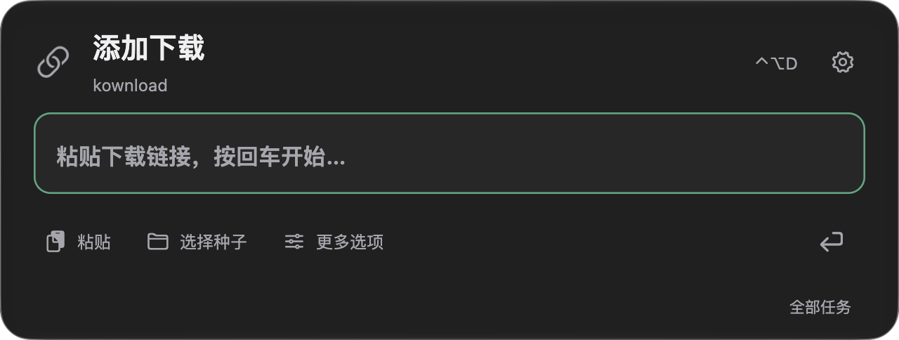
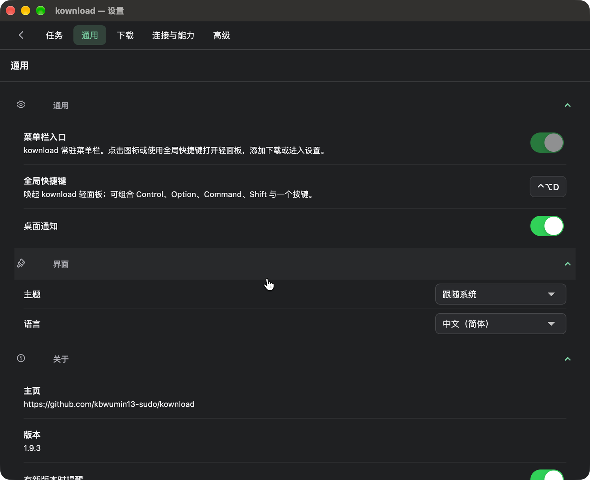

# kownload 原生面板验收

2026-10-14，macOS 27、Apple Silicon、Flutter 3.41.2。内核 `1.9.3-kownload.1`，应用 build 6。

## 已验证

- 90 项 Flutter 全量回归及最终请求鉴权、参数、导航和网盘待处理输入的相关回归通过。
- 实机保存设置发现并修复网盘配置被旧前端模型遗漏的问题；真实 HTTP 读写回归和两次界面开关保存均保留网盘参数。设置尺寸改用独立本地偏好，存储原生内容尺寸，避免重启叠加标题栏高度。
- 发布前移除媒体默认路径对本机用户名的依赖，改为当前用户目录；媒体包完整回归通过，重新构建内核并签名。
- Swift 正式宿主类型检查及 AppKit 回归通过：完整玻璃 contentView、旧系统与减少透明度分支、面板/设置反复切换、控件几何、输入树保留、原生文件选择/菜单/输入法 Escape、真正的 Carbon 快捷键成功与冲突、注销清理。
- 鼠标与拖放路由回归通过。187 项浏览器助手回归通过。
- 实机通过跨应用快捷键、输入焦点、Esc、失焦收起、设置切换与返回、中文文本及未提交内容保留；浅色和深色外观已检查。真实设置窗口与完整任务列表已检查。设置窗口退出重启前后均为900×732pt（内容900×700pt），返回面板为640×242pt。
- 使用隔离数据，由轻面板输入并回车提交 HTTP 64 MiB 下载；成功提示后自动收起，隐藏期间下载完成，SHA-256 正确。
- 正式应用已签名并安装，沿用原数据身份；安装前后 14 个既有任务、13 个扩展及完整后端配置相同。启动时的 BT 订阅缓存自动刷新已恢复为升级前值。只新增本地窗口/快捷键偏好。
- 主面板使用 `NSGlassEffectView` regular；透明 Flutter 内容直接位于其 contentView。公开截图是实际运行窗口抓取，没有合成桌面或替换材质。

## 验证边界

原生测试覆盖输入法候选优先关闭、旧系统材质、减少透明度与减少动态效果分支；真实输入法候选会话、多屏、全屏空间和复杂桌面背景尚未逐项实机验收。磁链/种子/媒体选择、深链接和隐藏时保留网盘流程由既有及本轮回归覆盖，未将每一项模拟回归计为真实站点端到端通过。

Flutter analyze 仍有上游生成 FFI 的 unused_element 警告及样式提示；本轮检查无受影响文件的新错误或警告，未将整仓分析退出码计为通过。

九类网盘已接入；夸克真实下载与暂停、重启、重新同步续传的结果见 [网盘覆盖](../NETDISK_PROVIDERS.md)。其余八盘、目录/多文件和真实转存清理矩阵未完成实机验证；移动/123显式转存尚不支持，缺稳定 UID 的平台重认证后的副本恢复/清理仍保持拒绝。
